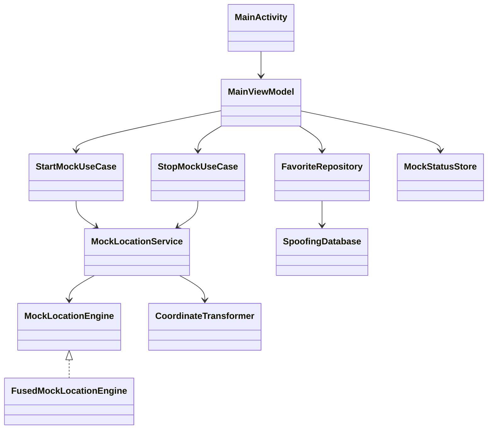

# Architecture

## Acceptance checklist
- App cold start target <= 3s (device dependent)
- Map tap response <= 200ms
- Mock injection interval 800ms, first injection target <= 1s
- Stop simulation returns `MockStatus.Idle`
- Permissions and developer-options guidance shown when unavailable
