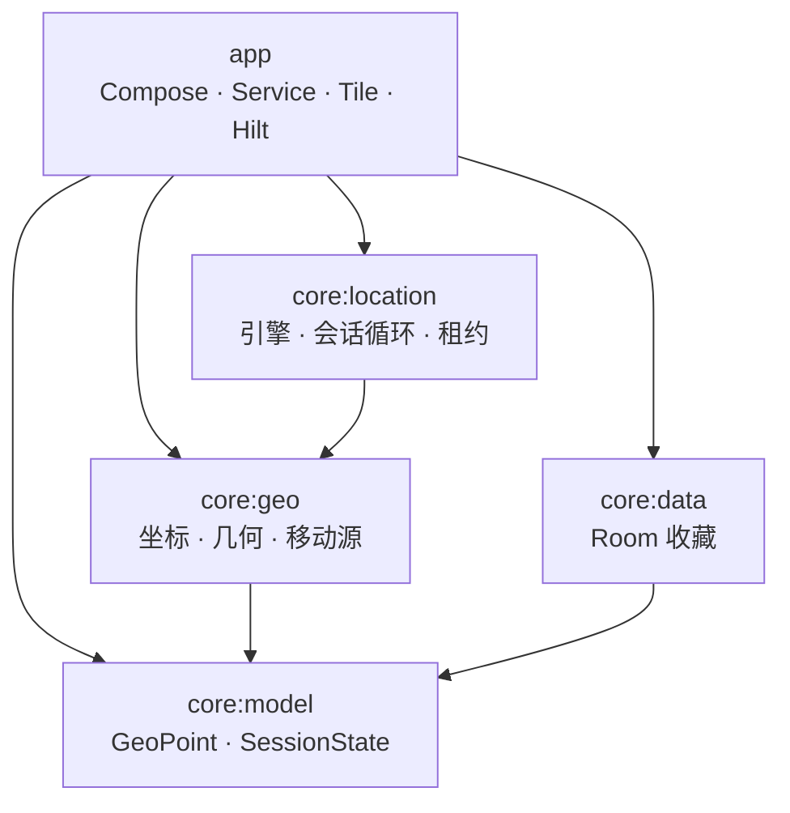
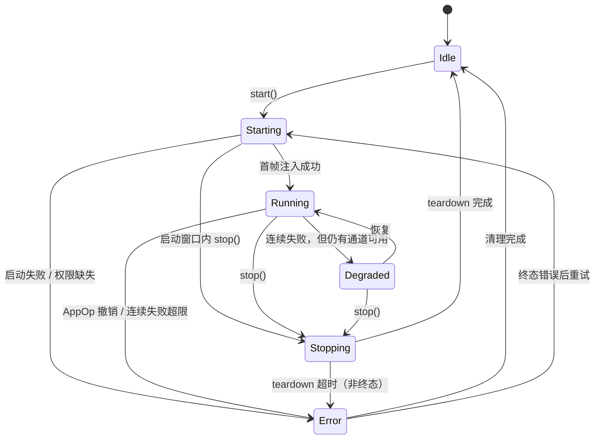

# 设计说明

本文描述当前实现的结构与约束。**代码是最终事实来源**；出现分歧时以代码为准，并回头修正本文。

---

## 1. 设计目标与不变量

1. **单一事实来源**：`SessionState` 是会话阶段、计时起点和最后注入点的唯一来源。runner、前台服务、通知、快捷磁贴和 UI 都从这一条流派生，任何一方都不得自行推断阶段或计时。
2. **内部一律 WGS84**：`GeoPoint` 自带 `CoordType`；GCJ02 只在 AMap 边界出现，并立即转换。两者相差数百米，混用不会被编译器发现，所以必须在类型上留痕。
3. **超时是失败，不是取消**：`kotlinx.coroutines.TimeoutCancellationException` 继承自 `CancellationException`。引擎层统一用 `withTimeoutOrNull`，超时按失败结果处理；真正的 caller cancellation 必须原样重抛。
4. **provider 所有权是启发式的**：`gps` / `network` 是全局 provider 名，租约只能证明"本应用可能注册过"，不能证明"当前是本应用注册的"。清理逻辑必须在无法确认移除时保留租约，等待下次冷启动重试。
5. **一个进程一个 store**：`MockStatusStore` 是进程内单例。永远不要给 `MockLocationService` 加 `android:process`，否则 UI 会看到 `Idle` 而服务正在注入。

---

## 2. 模块与依赖

- `core:model` 与 `core:geo` 只应用 `mobilespoofing.kotlin.jvm`，classpath 上没有 `android.jar` —— 纯 JVM 边界由编译器强制。
- `build-logic/` 提供 convention 插件：`mobilespoofing.android.application`、`.library`、`.compose`、`.hilt`、`.kotlin.jvm`。
- 版本统一由 `gradle/libs.versions.toml` 管理；SDK level 以整数形式存放，convention 插件用 `toInt()` 解析。

---

## 3. 会话状态机

### 关键约束

| 状态 | 含义 | 计时器 | 可开始 | 可停止 |
| --- | --- | --- | :---: | :---: |
| `Idle` | 没有会话 | — | ✅ | — |
| `Starting` | 已请求启动，引擎尚未就绪 | — | — | ✅ |
| `Running` | 至少一个引擎在注入 | `sessionEpochElapsedMs` | — | ✅ |
| `Degraded` | 仍在运行，但部分推送被拒 | 保留 | — | ✅ |
| `Stopping` | 正在注销 provider | 保留 | — | ✅ |
| `Error(terminal)` | 会话已结束 | 清除 | ✅ | — |
| `Error(non-terminal)` | teardown 超时，provider 可能仍在注销 | 清除 | — | — |

- **epoch**：runner 在引擎接受会话后捕获一次，整个会话恒定。`Running` / `Degraded` 不携带逐秒时间戳，因此静态会话只发布一次状态，路线会话只在坐标变化时发布。
- **Degraded 不是失败**：至少一条注入路径仍可用，用户可以继续使用，也可以停止。它携带 `SessionDegradedReason`（推送被拒 / 权限撤销 / provider 冲突 / 引擎超时）和连续失败计数。
- **Error 不携带展示文案**：`SessionErrorReason` 是纯枚举，本地化在 UI / 服务边界完成（`SessionReasonText.kt`）。
- **canStart / canStop**：`MainUiState` 从 `SessionState` 派生；非终态 Error 也阻止开始，因为 provider 可能仍在注销。

---

## 4. 注入管线

### 4.1 双引擎

| 引擎 | 覆盖对象 | 启动 | 停止 |
| --- | --- | --- | --- |
| `LocationManagerMockEngine` | 直接读 `LocationManager` 的应用 | 先 | 后 |
| `FusedMockLocationEngine` | 使用 Google Fused 客户端的应用 | 后 | 先 |

`CompositeMockLocationEngine` 聚合结果：任一引擎启动成功即视为部分成功；全部失败才算会话启动失败。推送同理——任一成功即 `Ok`，全部被拒才是 `AllRejected`。

### 4.2 超时

| 阶段 | 超时 | 说明 |
| --- | ---: | --- |
| 单引擎启动 | 5 s | 一个引擎超时不影响下一个 |
| 单次推送 | 1.5 s | 防止挂起的 Fused Task 卡住整个循环 |
| 单引擎停止 | 2 s | 按启动逆序停止 |
| 会话启动总预算 | 12 s | runner 层兜底 |
| teardown join | 3 s | 超时进入非终态 Error，拒绝新启动 |

### 4.3 provider 租约与冷启动清理

1. `addTestProvider` **之前**把 `ProviderLease(sessionId, startedAt, providers, packageName)` 写入 SharedPreferences（IO 线程 `commit()`，不是 `apply()`）。
2. 停止时逐个 provider 返回 `ProviderStopResult(provider, removed, reason)`；只有确认移除（成功，或本来就不存在）才释放对应租约。
3. `SpoofingApp.onCreate` 在 IO 线程启动清理 job；服务启动时先 join 清理，确保"清理"和"注册"不重叠。
4. `force-stop` 不会执行 `onTerminate`，残留只能在**下次冷启动**清理——这是已接受的限制。

### 4.4 失败终止

- 连续推送失败达到 5 次 → 终止会话，`finally` 负责 teardown。
- 运行中周期性复检 mock AppOp；被撤销则终止并清理。
- 所有 provider 推送失败时，做一次有界退避的 remove / add / enable 重注册，并重新检查 AppOp。

---

## 5. 坐标系

| 场景 | 数据来源 | 处理 |
| --- | --- | --- |
| 地图点选 | AMap，GCJ02 | `CoordinateTransformer.toWgs84`，入口即转换 |
| 坐标输入 | `lat,lon` / `geo:`，WGS84 | 校验有限性、纬度 ±90、经度 ±180 |
| 收藏 | 本地 Room | 统一存 WGS84；读取时按需转换 |
| 注入 | 引擎 | 只接受 WGS84 |

UI 的坐标输入标注为 `WGS84`；地图是 GCJ02。把界面坐标复制到高德时会有几百米偏移，这是基准面差异，不是 bug。

---

## 6. UI 设计系统

方向：安静、精密的"仪器"质感——大留白、1 px 发丝线、近单色底 + 小面积语义色。

### 6.1 Token

- `ui/theme/Color.kt`：`AppColors` 语义调色板，明暗两套；消费方通过 `MaterialTheme.appColors` 读取，不写颜色字面量。
- `ui/theme/Dimens.kt`：`AppSpacing`（4 → 32 dp）、`AppRadius`（卡片 20 / 控件 16 / chip 12）、`AppSize`（触控 48、主按钮 52、地图 280）。
- `ui/theme/Type.kt`：系统字体，数字使用等宽数位，坐标与计时不抖动。

语义色只用于状态、选中与小图标：琥珀 = 运行/待处理，青色 = 路线/交互，薄荷 = 完成/已授权，红色 = 异常。

### 6.2 组件

| 组件 | 职责 |
| --- | --- |
| `AppTopBar` / `StatusPill` | 应用标识与状态胶囊 |
| `StatusHero` | 当前模拟位置、模式、计时、途经点数 |
| `ModeSegmentedControl` | 单点 / 路线切换，滑动白色指示块，无 ripple |
| `MapCard` | 内联地图预览；点击进入全屏选点 |
| `CoordinateInputField` | WGS84 坐标输入与校验 |
| `RouteControls` | 速度、到达行为、撤销、清空 |
| `SetupChecklist` | 定位权限 / 模拟位置应用 / 电池白名单 / 通知权限 |
| `FavoriteSection` | 收藏列表、保存、删除 |
| `BottomActionBar` | 开始 / 停止主操作 |

### 6.3 动效

- 180–280 ms 的淡入与位移；运行中 1.6 s 呼吸点。
- 分段控件使用 spring 滑块，按压时只缩放标签，不改变指示块颜色。
- 系统动画缩放关闭时全部动效禁用（`Motion.kt`）。

### 6.4 状态覆盖

空选点、路线过短、权限缺失、模拟应用未设置、通知被拒、收藏为空、地图未授权、地图不可用、启动中、运行中、降级、停止中、异常——每种都有专门呈现。

---

## 7. 本地化与可访问性

- 默认中文（`values/`），英文在 `values-en/`；`locales_config.xml` 声明支持的语言，用户可在系统设置中单独切换本应用语言。
- 所有用户可见文案走资源文件；`SessionErrorReason` / `SessionDegradedReason` 在边界本地化。
- 触控目标 ≥ 48 dp；纯图标控件带 `contentDescription`；地图预览整体可点击并提供 `onClickLabel`。
- 已知缺口：320 dp + 1.3x 字号尚未自动化验证；深色模式下 AMap 仍为白天地图样式。

---

## 8. 验收标准

### 构建与测试

- `./gradlew verify` 通过：Debug APK + 227 个 JVM 测试，0 失败。
- `./gradlew lint` / `:app:lintVitalRelease` 通过。
- `:core:data:connectedDebugAndroidTest` 在设备上 4/4 通过（本地执行，CI 不跑）。

### 运行时

- 注入间隔 1000 ms（`SessionConfig.DEFAULT_INTERVAL_MS`），首帧目标 ≤ 1 s。
- 运行中重复开始被状态机拒绝，不会拆掉新会话。
- 启动期间取消仍会注销系统 test provider。
- 停止后回到 `Idle`，provider 清理完成；空闲状态下的停止请求不会留下服务。
- `am force-stop` 后重新启动，冷启动清理移除残留 provider。
- 权限与开发者选项缺失时给出指引，并在 `onResume` 刷新。
- 冷启动目标 ≤ 3 s（设备相关）；地图点按响应 ≤ 200 ms。

### 设备矩阵（仍未完成）

- ARM 真机上的 AMap 底图渲染。
- 两台不同 OEM 的前台服务 / Doze / 通知行为。
- 16 KB page size 设备。
- 320 dp / 1.3x / RTL 的截图验证。

---

## 9. 文档索引

| 文档 | 内容 |
| --- | --- |
| [README.md](README.md) | 项目简介、快速开始、能力边界 |
| [docs/README.md](docs/README.md) | 文档总索引 |
| [docs/optimization/2026-10-29/00-index.md](docs/optimization/2026-10-29/00-index.md) | Phase 0 / Phase 1 优化、审计与最终验证 |
